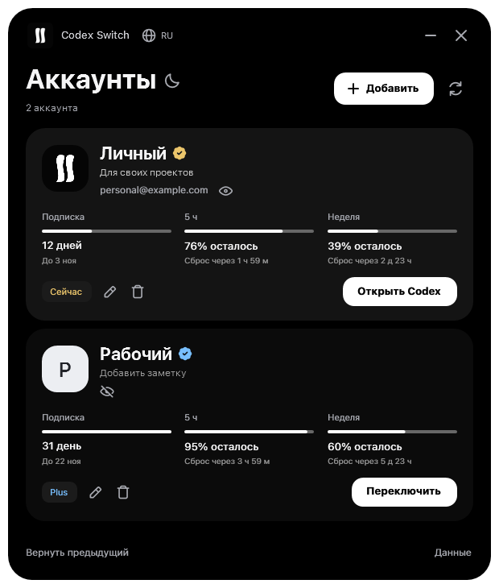
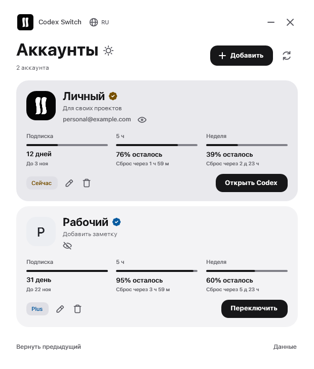

# swix

Windows apps & game projects.

  
  
  

## Codex Switch

Switch saved accounts in the Codex desktop app. Check limits and reset times, add notes, and get Windows notifications when a limit recovers.

**OLED & light themes · RU / EN · Windows 10 / 11**

  
  

[View project](https://github.com/2bekind/codex-switch) · [Download for Windows](https://github.com/2bekind/codex-switch/releases/latest)

---

### Support my projects

